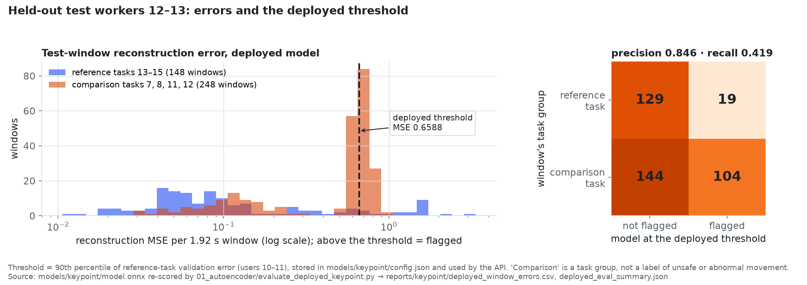

# Keypoint autoencoder

This folder contains the notebook and utilities for training and evaluating the pose-keypoint autoencoder used by Motion Atlas. The app analyzes movement deviation from a reference set; it does not estimate fatigue, workload, injury risk, or safety.

## Dataset

We use the **VTT-ConIoT** construction activity dataset. It contains data from **13 participants** performing **16 activities**, with wearable IMU recordings from three body locations and complementary video-derived pose keypoints. The original Zenodo download is **363 MB**. This keypoint experiment uses the pose-keypoint data, not the raw video or the IMU channels.

- Source and download: [VTT-ConIoT on Zenodo](https://doi.org/10.5281/zenodo.4683703)
- Dataset license: **CC BY 4.0**. Follow the source’s attribution terms when redistributing or publishing derived material.
- The repository does not include the raw dataset. Obtain it from Zenodo and follow its terms.

For this experiment, the participant split is fixed to avoid leakage: participants 1–9 for training, 10–11 for validation, and 12–13 for testing. The model learns reference movement from tasks 13, 14, and 15 (walking straight, winding walking, and pushing a cart). Tasks 7, 8, 11, and 12 are held out as comparison activities for evaluation. These task labels are not fatigue or injury labels.

At the deployed confidence cutoff (`pmin = 0.02`), preprocessing produced **1,473 training windows, 225 validation windows, and 396 test windows**. The test set contains 148 reference windows and 248 comparison windows. A window contains 48 frames at 25 fps (1.92 seconds), with 17 COCO body joints and x/y coordinates: 48 × 17 × 2 = **1,632 input values**. Training windows use a 24-frame stride. Low-confidence points are handled by the shared preprocessing in [`keypoint_utils.py`](keypoint_utils.py); preprocessing and scaling are fitted using training data only.

## Model and scoring

The selected setup is a **dense autoencoder with a 16-value latent representation**. It maps each normalized 48-frame pose window into a compact representation and reconstructs the input. The reconstruction mean squared error (MSE) is the movement-deviation score: higher error means the window differs more from the model’s reference movement.

The deployed model configuration uses a threshold of **0.65884**. This is the 90th percentile of normal validation reconstruction error stored in the deployed model configuration. A window above the threshold is flagged for review; it is not a diagnosis or a validated measure of worker condition.

## Setups compared

The table below reports the deployed run (the one whose setup A weights are in `models/keypoint/model.onnx`, SHA-256 `67fc9551…`). Precision and recall use each setup's own validation 90th-percentile threshold. The two reference methods are comparison baselines, not autoencoders.

| Setup | Parameters | Validation MSE (normal) | Test MSE (all) | Test ROC AUC | Test precision | Test recall |
|---|---:|---:|---:|---:|---:|---:|
| **A — Dense, latent 16 (deployed)** | 423,792 | **0.2079** | **0.4320** | 0.784 | 0.846 | 0.419 |
| B — Conv1D, latent 16 | 78,066 | 0.3095 | 0.7845 | 0.807 | 0.901 | 0.585 |
| C — Conv1D, latent 8 | 71,914 | 0.3040 | 0.8689 | 0.814 | 0.913 | 0.637 |
| Reference — PCA, 8 components | 13,056 | 0.2670 | 0.4504 | 0.766 | 0.238 | 0.020 |
| Reference — pose deviation | — | — | — | **0.843** | 0.891 | **0.657** |

Setup A was selected for the app because it had the lowest validation reconstruction MSE among the three autoencoder candidates. It does **not** lead every metric: setups B and C and the pose-deviation reference all have a higher test ROC AUC and recall. This is a small, participant-limited evaluation, not evidence of general performance on all construction footage.

Setup A's architecture: 48 × 34 input → 128 → 16-number latent code → 128 → 48 × 34 reconstruction. At the live threshold (0.6588) on the 396 held-out test windows: TN 129, FP 19, FN 144, TP 104 (precision 0.846, recall 0.419, F1 0.561). These values are in [`deployed_run_setups_table.csv`](../reports/keypoint/deployed_run_setups_table.csv) and [`deployed_eval_summary.json`](../reports/keypoint/deployed_eval_summary.json).

> **Legacy evidence, not the deployed model.** [`setups_table.csv`](../reports/keypoint/setups_table.csv) and [`pmin_sensitivity.csv`](../reports/keypoint/pmin_sensitivity.csv) come from a different, non-deployed training run (setup A: validation MSE 0.2086, threshold 0.6765, ROC AUC 0.788, precision 0.881, recall 0.536). Its weights are not in this repository, so those results cannot be reproduced. They are kept for the record only; see [`reports/keypoint/README.md`](../reports/keypoint/README.md).

## Figures

**Deployed model: test-window errors.** Reconstruction error of the 396 test windows from the deployed model, with the live threshold.

**Legacy evidence (non-deployed run).** [`keypoint_anomaly_figure.png`](../reports/keypoint/keypoint_anomaly_figure.png) shows the same kind of view for the earlier, non-deployed run. It is not a deployed-model result.

**Posture-angle context by activity.** This is a descriptive view of the keypoint data; it is not the autoencoder’s anomaly score and does not measure fatigue or safety.

The posture reports are in [`reports/keypoint/`](../reports/keypoint/). The deployed comparison values are in [`deployed_run_setups_table.csv`](../reports/keypoint/deployed_run_setups_table.csv); the `pmin` sensitivity table there ([`pmin_sensitivity.csv`](../reports/keypoint/pmin_sensitivity.csv)) is legacy evidence from the non-deployed run.

## Model files

The trained artifacts are published in the [Motion Atlas Hugging Face model repository](https://huggingface.co/iaac-maai/hackathon-team3-movement-strain-ae). The app loads the keypoint artifacts from this repository at runtime through the model server. The ONNX model, saved scaler, and `config.json` must be kept together because the scoring path uses all three.

## Limitations

- Only two participants are in the held-out test split. Results can change substantially with more participants, different clothing, camera angles, occlusion, or detector errors.
- The autoencoder learns reference-task movement patterns; it has no fatigue, workload, injury, or safety labels. A flagged window means “different from this reference,” not “unsafe” or “fatigued.”
- The pose-deviation reference (and setups B and C) outperform the selected autoencoder on test ROC AUC in this run. The app uses the autoencoder for its reconstruction-based score, not because it wins every benchmark metric.
- Tracking, keypoint confidence, and preprocessing can affect what reaches the model. Multi-person identity tracking remains experimental.
- The selected model and threshold are a prototype evaluation and require broader validation before operational use.

## Files

- [`keypoint_anomaly.ipynb`](keypoint_anomaly.ipynb) — training and evaluation notebook.
- [`keypoint_utils.py`](keypoint_utils.py) — keypoint loading, splitting, preprocessing, and window construction.
- [`video_to_keypoints.py`](video_to_keypoints.py) — extracts keypoint CSVs from video for evaluation workflows.
- [`score_keypoints.py`](score_keypoints.py) — scores a keypoint CSV or folder with the saved model.
- [`reports/keypoint/deployed_run_setups_table.csv`](../reports/keypoint/deployed_run_setups_table.csv) — setup comparison metrics for the deployed run.
- [`reports/keypoint/setups_table.csv`](../reports/keypoint/setups_table.csv), [`pmin_sensitivity.csv`](../reports/keypoint/pmin_sensitivity.csv), [`keypoint_anomaly_figure.png`](../reports/keypoint/keypoint_anomaly_figure.png) — **legacy evidence from the non-deployed run**; not deployed-model results.

Dataset: Mäkelä et al., VTT-ConIoT, [Zenodo record 4683703](https://doi.org/10.5281/zenodo.4683703).
