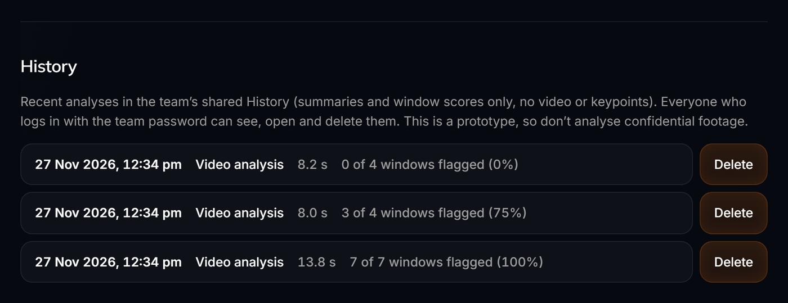
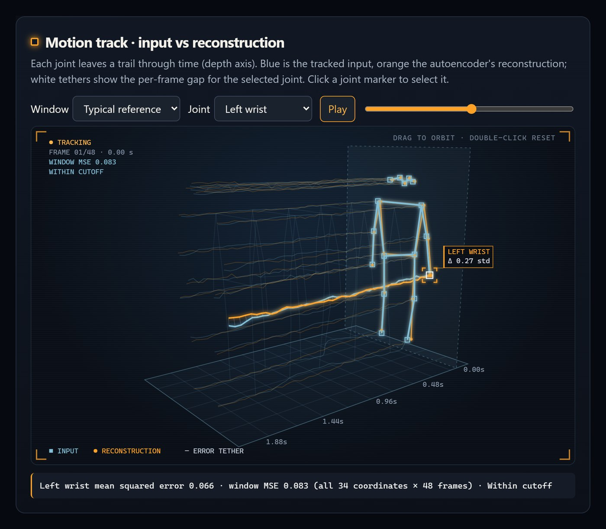
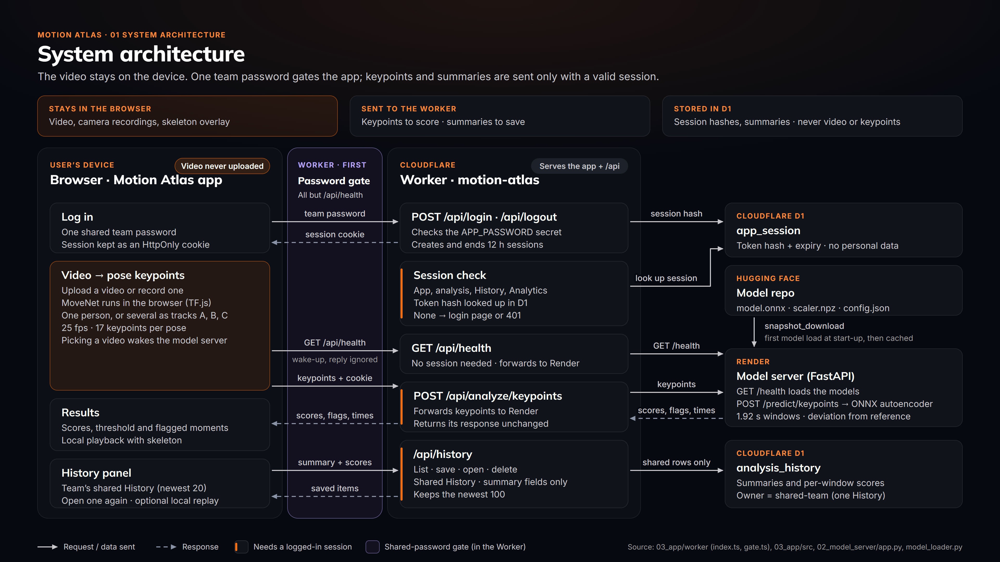
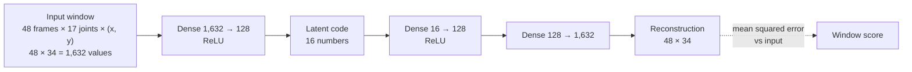
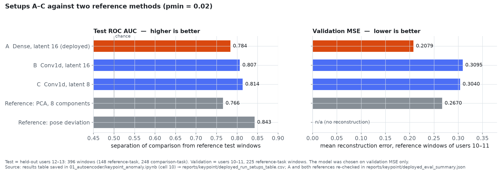

# Motion Atlas: movement deviation review for construction work


*A real result from the deployed keypoint model (threshold 0.6588) on an 8-second demo clip recorded by the team, shown with the consent of the person filmed. The app ran locally on the same model files that are published to Hugging Face. The video is paused at 0:03, inside the first flagged window. Video and result panels are crops of one screenshot, placed side by side. The score shows movement deviation only, not fatigue or safety.*

| History | Model tab |
|---|---|
|  |  |
| Saved summaries of three demo-clip analyses. Only scores and times are stored, never video or keypoints. | Input (blue) against reconstruction (orange) for one reference window. **Note:** this tab's built-in data comes from an earlier training run, not the deployed weights. See [evidence notes](#evidence-notes). |

**Project:** AI Methods I hackathon, Group 3 (IAAC, MaAI 2026/27)
**Dataset:** [VTT-ConIoT](https://doi.org/10.5281/zenodo.4683703): 13 construction workers, 16 activities, wearable IMU and video pose keypoints

Motion Atlas lets a site lead pick a work video and see **when a worker's movement differs from reference movement**. The video is processed in the browser and is never uploaded: only body keypoints are sent for scoring. An autoencoder trained on reference movement rebuilds each 1.92-second pose window, and windows it rebuilds badly are flagged for review.

> **What the score is, and is not.** The score is a reconstruction error: how far a movement is from the model's reference data. It is not a measure of fatigue, workload, injury risk or safety, and it is not a diagnosis. The dataset has no such labels.



## Status

| Part | Folder | Status |
|---|---|---|
| IMU autoencoders (Day 1) | `src/`, `models/`, `reports/` | Done: three models compared (see [Day 1](#day-1-imu-autoencoders)) |
| Video-keypoint autoencoder | `01_autoencoder/` | Done: three autoencoders and two reference methods compared; the dense AE (16-value code) is deployed |
| Scoring API (FastAPI + ONNX, on Render) | `02_model_server/` | Deployed; keypoint model in use by the app |
| Web app (React + Cloudflare Worker + D1) | `03_app/` | Deployed: login, video analysis, History, Schedule, multi-person (experimental) |
| Model evaluation tab (interactive 3D graphs) | `03_app/public/graphs/` | On `main` (PR #7); local tests pass; not yet deployed |
| Final diagrams | `04_final/diagrams/` | Done: four SVG + PNG diagrams |

Checks: the app's test suite (`npm test` in `03_app`) passes, 145 tests; the app and Worker typecheck cleanly.

## How it works

1. **In the browser:** MoveNet (TensorFlow.js) extracts 17 body keypoints per frame at 25 fps. The video never leaves the browser.
2. **Cloudflare Worker** (`03_app/worker/`): checks the login session and forwards the keypoints to the scoring API.
3. **Scoring API on Render** (`02_model_server/`): normalizes the pose, cuts 48-frame windows, runs the ONNX autoencoder and returns one score per window, the threshold, and an approximate 2D posture summary.
4. **Back in the browser:** a score timeline, flagged moments you can jump to in the local video, the skeleton drawn over the video, and input-quality warnings.
5. **History (Cloudflare D1):** each analysis summary is saved to the team's shared History (scores and times only; never video, keypoints or file names).

The **Schedule** tab drafts a shift plan with breaks; it stays on the page and is not saved. **Multi-person** analysis tracks several people (A, B, C…) and scores each track; it is experimental and is not saved to History.

## The keypoint model

Each input is a window of **48 frames (1.92 s at 25 fps) × 17 joints × (x, y) = 1,632 values**. Coordinates are centered on the hips, scaled by torso length and standardized with training statistics. Low-confidence points are interpolated, and windows with more than 30% missing points are dropped.

- **Reference ("normal") movement:** tasks 13, 14 and 15 (walking straight, winding walking, pushing a cart). The model is trained only on these.
- **Comparison movement:** tasks 7, 8, 11 and 12, used only for evaluation.
- **Participant split:** users 1–9 train, 10–11 validation, 12–13 test. No participant appears in two splits.
- **Threshold:** the 90th percentile of reference validation error, **MSE 0.6588** (`threshold_mse` in [`models/keypoint/config.json`](models/keypoint/config.json)). A window above it is flagged.

### The deployed network (setup A)

A small dense autoencoder. It squeezes each pose window into **16 numbers** and rebuilds the window from them. Movement unlike the reference tasks is rebuilt worse, so its error is higher.



- **Layers and size:** encoder `Linear(1632, 128) → ReLU → Linear(128, 16)`; decoder `Linear(16, 128) → ReLU → Linear(128, 1632)`, reshaped back to 48 × 34. There is no activation on the 16-number code. That makes **423,792 trainable parameters** (209,024 + 2,064 + 2,176 + 210,528).
- **Checked against:** the PyTorch definition (`Dense` in [`01_autoencoder/keypoint_anomaly.ipynb`](01_autoencoder/keypoint_anomaly.ipynb)) and the deployed ONNX graph [`models/keypoint/model.onnx`](https://huggingface.co/iaac-maai/hackathon-team3-movement-strain-ae/tree/main/keypoint). The graph takes `keypoint_window (batch, 48, 34)` and outputs `embedding (batch, 16)` and `reconstruction (batch, 48, 34)`.
- **Training:** Adam (learning rate 0.001), batch 64, at most 40 epochs, early stopping after 6 epochs without validation improvement, seed 42. The weights from the epoch with the lowest validation error are kept.
- **Score:** the mean squared error over all 1,632 values of the window, in standardized units. It is **not an accuracy**: lower means the movement is closer to the reference tasks.

### Training and validation loss


*Training split: reference-task windows of users 1–9 (1,473). Validation split: users 10–11 (225). Source: the training log saved in the notebook, extracted to [`reports/keypoint/deployed_run_training_history.csv`](reports/keypoint/deployed_run_training_history.csv).*

### Setups A–C against two reference methods

| Setup | Parameters | Validation MSE ↓ | Test ROC AUC ↑ | Test precision | Test recall | Threshold (MSE) |
|---|---:|---:|---:|---:|---:|---:|
| **A Dense, latent 16 (deployed)** | 423,792 | **0.2079** | 0.784 | 0.846 | 0.419 | 0.6588 |
| B Conv1d, latent 16 | 78,066 | 0.3095 | 0.807 | 0.901 | 0.585 | 1.1723 |
| C Conv1d, latent 8 | 71,914 | 0.3040 | 0.814 | 0.913 | 0.637 | 1.2108 |
| Reference: PCA, 8 components | 13,056 | 0.2670 | 0.766 | 0.238 | 0.020 | 1.0259 |
| Reference: pose deviation | — | — | 0.843 | 0.891 | 0.657 | 1.8396 |



*Validation MSE (lower is better) is mean reconstruction error on the 225 reference-task windows of users 10–11. It is the only criterion used to choose the deployed model. Test ROC AUC (higher is better; 0.5 is chance) measures how well each score separates the 248 comparison-task windows from the 148 reference-task windows of held-out users 12–13. Precision and recall use each method's own 90th-percentile validation threshold. Source: [`reports/keypoint/deployed_run_setups_table.csv`](reports/keypoint/deployed_run_setups_table.csv). The A, PCA and pose-deviation rows were re-checked by re-scoring, in [`reports/keypoint/deployed_eval_summary.json`](reports/keypoint/deployed_eval_summary.json).*

A reconstructs reference movement best, which is why it was chosen. But it does not separate the task groups best: B, C and the simple pose-deviation baseline reach a higher test AUC. Picking on validation reconstruction alone favoured the model that also rebuilds unfamiliar movement fairly well.

### Test result at the deployed threshold


*Held-out test users 12–13: 396 windows. Source: the deployed model file ([`keypoint/model.onnx` on Hugging Face](https://huggingface.co/iaac-maai/hackathon-team3-movement-strain-ae/tree/main/keypoint), identical to the local `models/keypoint/model.onnx`) re-scored with its scaler by [`01_autoencoder/evaluate_deployed_keypoint.py`](01_autoencoder/evaluate_deployed_keypoint.py). Output: [`reports/keypoint/deployed_window_errors.csv`](reports/keypoint/deployed_window_errors.csv) and [`deployed_eval_summary.json`](reports/keypoint/deployed_eval_summary.json).*

**What the threshold means:** 0.6588 is the error that 90% of reference-task validation windows stay under; 23 of the 225 exceed it. Above it, a window is flagged for human review.

**What the test result means:** the deployed model flags 123 of the 396 test windows. Of those, 104 come from comparison tasks (precision 0.846), so 104 of the 248 comparison windows are caught (recall 0.419, F1 0.561). Another 19 of the 148 reference windows are flagged. Many comparison windows sit just below the threshold, which is why recall is moderate. ROC AUC over all thresholds is 0.784.

"Comparison task" is a group of different activities, not a label of unsafe or abnormal movement. These numbers measure how well reconstruction error separates two task groups for two held-out workers. They are not an accuracy, and not a measure of fatigue or safety.

The **Model** tab in the app shows interactive 3D views: input against reconstruction, the validation error distribution, a per-window score track, a confusion matrix with a movable threshold, and split coverage. Its built-in data is from the earlier run described below.

### Evidence notes

- **Two training runs are in the repository; only one is deployed.** The live API loads `keypoint/model.onnx` from Hugging Face. On 27 Nov 2026 that file had the same SHA-256 (`67fc9551…`) as `models/keypoint/model.onnx`, and the live `/health` reported threshold 0.6588. Re-scoring that file reproduces the notebook's saved outputs exactly (validation MSE 0.207885, threshold 0.65884), so every number above comes from that run.
- **Older figures from the other run.** [`reports/keypoint/setups_table.csv`](reports/keypoint/setups_table.csv), [`pmin_sensitivity.csv`](reports/keypoint/pmin_sensitivity.csv), [`keypoint_anomaly_figure.png`](reports/keypoint/keypoint_anomaly_figure.png) and the Model tab's built-in data come from a different run: validation MSE 0.2086, threshold 0.6765, precision 0.881, recall 0.536. That run's weights are not in this repository or on Hugging Face, so its results can't be reproduced. An earlier version of this README quoted them for the deployed model. **Needs review:** regenerate or retire those files and the Model tab data.
- **Re-running:** `python 01_autoencoder/evaluate_deployed_keypoint.py` (needs the VTT-ConIoT keypoint CSVs in `data/`), then `extract_notebook_results.py` and `make_readme_figures.py`. Nothing is retrained.

## Repository map

| Path | Contents |
|---|---|
| `01_autoencoder/` | Keypoint autoencoder notebook, video-to-keypoints converter, scoring utilities |
| `02_model_server/` | FastAPI + Gradio scoring service, Render blueprint, tests ([README](02_model_server/README.md)) |
| `03_app/` | Motion Atlas web app: React (Vite), Cloudflare Worker, D1 migrations, tests ([README](03_app/README.md)) |
| `04_final/diagrams/` | Final presentation diagrams, editable SVG + PNG ([README](04_final/diagrams/README.md)) |
| `hf_upload/` | Model files (`model.onnx`, `scaler.npz`, `config.json`) as published to Hugging Face for the API |
| `models/`, `reports/` | Model weights, scalers, configs, metrics and figures (IMU and keypoint) |
| `src/` | Day 1 IMU training scripts |
| `slides/` | Day 1 presentation |
| `model_app/` | The course's example model server (Fashion-MNIST); a reference, not part of Motion Atlas |
| `data/` | Local dataset files; not in Git |

## Running it locally

Model API (Python), from the repository root:

```powershell
python -m pip install -r 02_model_server/requirements.txt
python -m uvicorn app:app --app-dir 02_model_server --host 127.0.0.1 --port 8000
```

Web app (Node.js 22.6 or newer), in a second terminal:

```powershell
cd 03_app
npm install
copy .dev.vars.example .dev.vars   # then set APP_PASSWORD= to a local team password of your choice
npm run db:migrate:local
npm run dev                        # open http://localhost:5173 and log in with that password
```

The local database and password are separate from the deployed ones. Deployment steps (D1, the `APP_PASSWORD` secret, `npm run deploy`) are in [`03_app/README.md`](03_app/README.md).

## Limits

- **One reference activity group.** The model learned walking and cart pushing; any other activity scores as "different", by design. A flag means "review this window", not "this movement is wrong".
- **Recall is moderate.** About half of the comparison windows stay under the threshold (recall 0.536).
- **Two test workers.** Only participants 12 and 13 were held out, so results may not generalize to other people or camera setups.
- **2D pose from one camera.** MoveNet keypoints are approximate; knees and ankles are often missed, and the app warns when they are. The training data's pose detector is unknown.
- **Prototype security.** One shared team password protects the app, and everyone who has it shares the same History. Do not analyse confidential footage or sensitive personal data.

## Day 1: IMU autoencoders

*Monday 16 November 2026.* The first day explored the wearable-sensor (IMU) recordings before the project moved to video keypoints.

- Loaded and audited **207 IMU recordings** from 13 participants performing up to 16 activities.
- Prepared fixed-length sensor windows and split participants, not individual windows, between training, validation and test sets.
- Trained and compared a dense autoencoder and two 1D convolutional autoencoders.
- Saved model weights, input-scaling values, configuration files, metrics, loss curves and test reconstruction plots.

### Dataset

VTT-ConIoT contains wearable inertial-sensor measurements from **13 people** performing **16 activities** relevant to construction work. Sensors are worn at the **trousers, back, and hand**. The archive also contains video-derived body-pose keypoint CSVs.

The activities are roll painting, spraying paint, levelling paint, vacuum cleaning, picking objects, climbing stairs, jumping down, laying back, hands-up work at high and low levels, crouching on the floor, kneeling on the floor, walking straight, walking winding, pushing a cart, and stairs up-down.

The models use **18 channels**: acceleration (`Ax`, `Ay`, `Az`) and gyroscope (`Gx`, `Gy`, `Gz`) at each of the three sensor locations. Timestamps, magnetometer, barometer, and precomputed total-magnitude fields are not model inputs in these runs.

### Preprocessing and splits

- Sampling rate: **100 Hz**.
- Window length: **200 samples (2 seconds)**.
- Training stride: **100 samples (1 second)**; evaluation stride: **200 samples (2 seconds)**.
- Each channel is standardized using the mean and standard deviation from training participants only.
- Participant split: users **1–9** for training, **10–11** for validation, and **12–13** for testing. Participants do not overlap between splits.
- Random seed: **42**; batch size: **128**; maximum: **30 epochs**; early-stopping patience: **5**.
- Resulting windows: **8,295 train / 929 validation / 928 test**.

Activity labels are retained as metadata for analysis; the autoencoders learn by reconstructing their input windows.

### Model comparison

All three models used the same sensor channels, participant split, windowing, and standardization. MSE is calculated on standardized sensor signals; lower values mean more accurate reconstruction. The baseline reconstructs each channel as zero after standardization (the training-set mean).

| Setup | Architecture | Latent size | Parameters | Best validation MSE | Test MSE |
|---|---|---:|---:|---:|---:|
| 1 | Dense autoencoder | 32 | 1,884,336 | **0.43460** | **0.34056** |
| 2 | 1D convolutional autoencoder | 32 | 164,786 | 0.46382 | 0.36872 |
| 3 | 1D convolutional autoencoder | 16 | 113,570 | 0.56310 | 0.45708 |
| Baseline | Training-channel mean | — | — | — | 1.01121 |

Parameter counts are derived from each model’s layer dimensions. The dense AE has the lowest test MSE in these runs, about **66% below the baseline**. The 32-value convolutional AE is close, with about **64% lower** test MSE, while using substantially fewer parameters. Reducing the convolutional latent size to 16 increases test error to 0.45708, showing a reconstruction trade-off from stronger compression.

Training time was not recorded in the metrics files, so it is not included here.

### Training curves

Training and validation loss both fall across the runs. Validation loss stays above training loss, but does not turn upward late in training. This shows a generalization gap without a clear late-epoch validation collapse.

| Dense AE | Conv AE, latent 32 | Conv AE, latent 16 |
|---|---|---|
|  |  |  |

### Test reconstructions

These plots compare original and reconstructed signals for one fixed test window from `activity_10_user_12_combined.csv`. The models generally follow broad trends, but smooth or miss some abrupt peaks and dips. This is visible in all three plots and is an important limitation for short, sharp movements.

| Dense AE | Conv AE, latent 32 | Conv AE, latent 16 |
|---|---|---|
|  |  |  |

### Re-running the IMU models

Run from the repository root in a Python environment with PyTorch, NumPy, pandas and Matplotlib installed (`requirements-train.txt`). The dataset must be extracted under `data/VTT_ConIot_Dataset/`.

```powershell
python .\src\train_autoencoder.py
python ".\src\train_autoencoder v2.py"
python .\src\train_autoencoder_conv16.py
```

Each script writes its model artifacts and reports to the corresponding folders under `models/` and `reports/`.

## AI usage disclosure

### Tools
Claude and ChatGPT

### Why

We used AI assistance to move faster on unfamiliar machine-learning and web-development tasks, explore implementation options, and prepare first drafts of documentation and presentation material.

### Where (Monday–Thursday)
Monday: dataset exploration, data preparation, and comparisons of the initial IMU autoencoders. Tuesday–Thursday: work on the video keypoint model and web app, including analysis, tracking, authentication, History, scheduling and analytics; debugging and testing; and drafts or revisions of the diagrams, README content and presentation script.

### How
We treated AI output as a starting point, not as verified fact. We checked model and dataset claims against project files and results, reviewed code changes, and used builds, tests and browser checks to catch problems. We kept the IMU experiments separate from the keypoint model used by the app, and avoided putting secrets or video files into Git.

### Lessons learned
Training the dense autoencoder and two 1D convolutional autoencoders taught us that model choice depends on what we need the model to do. For the IMU experiments, the dense model had the lowest test reconstruction error, so we chose it as the best of those three for reconstructing IMU signals. Motion Atlas uses a separate keypoint autoencoder because the app analyzes pose extracted from video. We learned not to treat those models’ scores as directly comparable—or call reconstruction error “accuracy.” The results helped us choose a direction, but they don’t prove the model will generalize to every worker or site.

## Source and attribution

Dataset: [VTT-ConIoT on Zenodo](https://doi.org/10.5281/zenodo.4683703). The course `DATASETS.md` lists the dataset as CC BY 4.0; cite the dataset and paper when using it, and check the source record before redistributing raw files.

Mäkelä, S.-M., Lämsä, A., Keränen, J. S., Liikka, J., Ronkainen, J., Peltola, J., Häikiö, J., Järvinen, S., & López, M. B. (2022). “Introducing VTT-ConIoT: A Realistic Dataset for Activity Recognition of Construction Workers Using IMU Devices.” *Sustainability, 14*(1), 220. [https://doi.org/10.3390/su14010220](https://doi.org/10.3390/su14010220).
